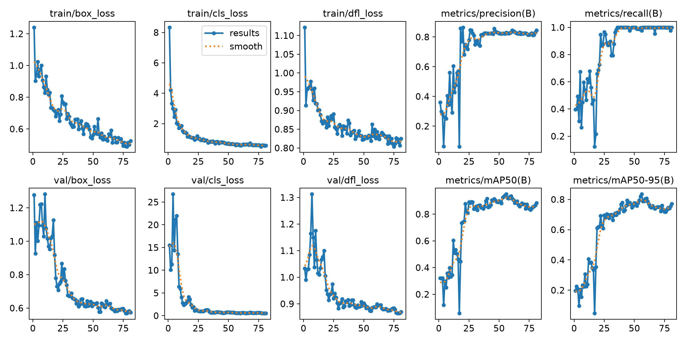
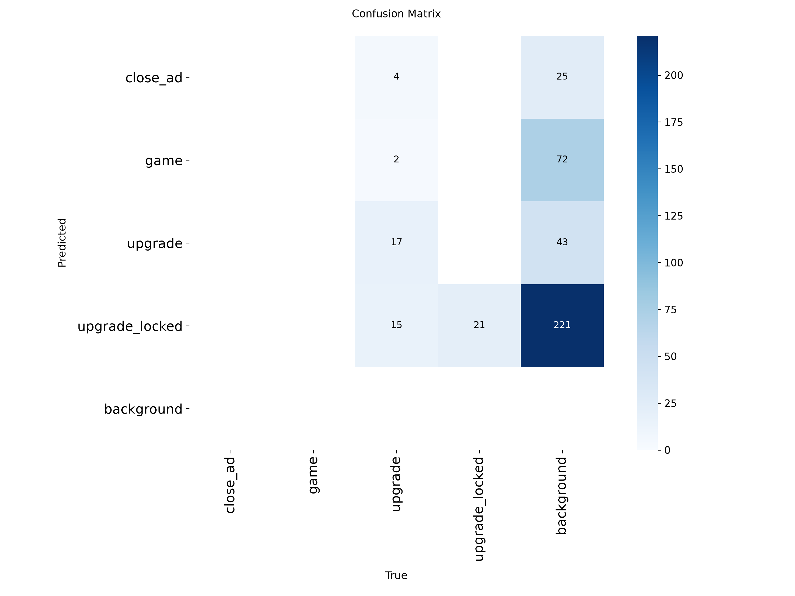

# Clicker AI: бот-кликер на YOLOv8

Проект из практической работы «ИИ от сбора до внедрения». Нейросеть YOLOv8 смотрит на экран с игрой «Из грязи в князи» (Яндекс Игры) и сама играет: кликает по доллару, закрывает рекламу и покупает доступные улучшения.

## Что умеет бот

1. **Закрывает рекламу.** Находит крестик (`close_ad`) и нажимает на него.
2. **Покупает улучшения.** Находит карточки магазина, определяет по цвету текста, хватает ли денег, и покупает самую дорогую из доступных. Между покупками выдерживается пауза.
3. **Кликает по доллару.** Находит главный объект (`game`) и делает быструю серию кликов.

Приоритет такой: реклама, затем улучшения, затем клики по доллару.

## Классы модели

| id | класс | что это |
|----|-------|---------|
| 0 | `close_ad` | кнопка закрытия рекламы |
| 1 | `game` | доллар, по которому кликаем |
| 2 | `upgrade` | доступное улучшение |
| 3 | `upgrade_locked` | недоступное улучшение (затемнено) |

Модель обучена на собственном датасете из скриншотов игры. Сам датасет в репозиторий не входит.

## Качество модели





## Структура проекта

```
clicker_ai_homework/
├── app.py            # бот
├── best.onnx         # обученная модель, её использует app.py
├── requirements.txt  # зависимости
└── runs/detect/cookie_detector-4/
    ├── weights/best.pt       # исходные веса (PyTorch)
    ├── results.png           # графики обучения
    └── confusion_matrix.png  # матрица ошибок
```

## Установка

Нужны Windows и Python 3.10 или новее.

```
git clone https://github.com/batt005/clicker_ai_homework.git
cd clicker_ai_homework
python -m venv .venv
.venv\Scripts\activate
pip install -r requirements.txt
```

## Запуск

1. Откройте игру в браузере: [Из грязи в князи](https://yandex.ru/games/app/iz-griazi-v-kniazi-352620). Окно с игрой и магазином должно быть видно на экране целиком.
2. В терминале выполните:

```
python app.py
```

3. В консоли появится список классов модели, после чего бот начнёт работать.

## Управление

| действие | как |
|----------|-----|
| **Аварийная остановка** | клавиша **Пробел** |
| Запасная остановка | резко увести мышь в левый верхний угол экрана |
| Отладка | **F9**: сохраняет `debug.png` и выводит в консоль таблицу найденных карточек (зелёные рамки будут куплены, красные пропущены) |

Пока бот работает, ничего не печатайте: пробел срабатывает в любом окне.

## Настройка

Все параметры находятся в начале `app.py`.

| параметр | что делает |
|----------|------------|
| `UPGRADE_COOLDOWN` | пауза между покупками улучшений, секунды |
| `CLICK_BURST` | длительность одной серии кликов по доллару, секунды |
| `CLICK_INTERVAL` | пауза между кликами (0 = максимально быстро) |
| `WHITE_RATIO_MIN` | доля белых пикселей, с которой карточка считается доступной |
| `SHOW_TIMING` | печатать время распознавания |

### Калибровка под свой экран

Если на другом мониторе бот покупает лишнее или пропускает доступное:

1. Запустите `python app.py` и нажмите **F9**.
2. Посмотрите в консоли долю белых пикселей у доступных и недоступных карточек.
3. Поставьте `WHITE_RATIO_MIN` посередине между ними.

## Технологии

Python, Ultralytics YOLOv8, ONNX Runtime, OpenCV, PyAutoGUI, X-AnyLabeling.